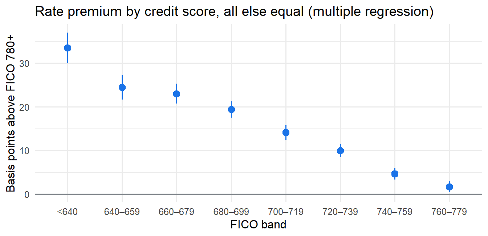
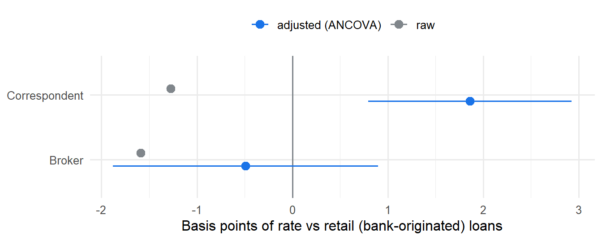

# Do mortgage brokers charge more?

**What sets the interest rate on a US mortgage: nonparametric tests, linear regression, ANCOVA and MANCOVA on 46,190 thirty-year loans originated in 2024.**

📊 [Full report](https://amaugomez.github.io/mortgage-pricing-regression/) · R · Data: [Freddie Mac Single-Family Loan-Level Dataset](https://freddiemac.com/research/datasets/sf-loanlevel-dataset)

*Author's note: this is the running case study of the Nonparametric and Regression Models course I teach at the Facultad de Ciencias, UNAM (syllabus 1639). Each chapter answers part of the question with one unit of the syllabus. Chapters are in Spanish; the report summarises them in English.*

---

## The answers

| Question | Answer |
|---|---|
| How much more does a weaker credit score pay, all else equal? | FICO 660–679 pays **+23 bp** vs FICO 780+ (≈ $46/month on a $300k loan); the penalty is gradual and non-linear, about a third of a point below 640 |
| Do brokers charge more than retail lenders, for the same risk? | **No, on average:** −0.5 bp (95% CI −1.9 to +0.9, Dunnett-adjusted). Correspondents charge slightly more: +1.9 bp (0.8 to 2.9) |
| What drives the rate most? | **The month the rate was locked** (22% partial R²), then occupancy, down payment, loan purpose and credit score |
| Do channels write different loans? (MANOVA / MANCOVA) | **Yes, but not in the rate:** jointly testing rate, LTV, DTI and loan size, 98% of the separation is loan size and down payment; at the same score and month, broker loans are ~25% larger with +3.5 points of LTV, at the same rate |

**Comparing without adjusting can reverse the answer.** Unadjusted, correspondents look 1.3 bp *cheaper* than retail lenders; for the same risk they are 1.9 bp *more expensive*, because retail lenders write twice as many cash-out refinances, which carry higher rates.

## How the analysis was checked

- **Rates are discrete and heaped** (76% on the 1/8-point grid, most of the rest ending in .99 or .49), so normality fails and rank-based tests come first. With 46,000 loans, results are reported as effect sizes, not just p-values.
- **Data consistency with McNemar's test** ("LTV above 80" vs "has mortgage insurance"), which later explains a severe multicollinearity (generalised VIF 14.8) if both enter the model.
- **Functional form:** within one month a straight line in FICO is adequate (lack-of-fit F test, AIC); over the full year, with month adjustment, score bands fit clearly better.
- **Assumptions:** Breusch–Pagan rejects constant variance → HC3 robust SEs; homogeneity of slopes tested before reading the ANCOVA (the broker gap is a few bp cheaper for FICO 740+ and a few bp dearer at 660–739); results hold with extra controls and in the most homogeneous segment; stepwise AIC/BIC and 5-fold cross-validation for model selection.
- **Limits:** the data record the rate, not fees or discount points (so: same *rate*, not same *total cost*); channel choice is not random (association, not causation); conforming loans only.

## Chapters (Spanish)

| | Chapter | Syllabus unit | What it finds |
|---|---|---|---|
| 0 | [The question](https://amaugomez.github.io/mortgage-pricing-regression/chapters/0-la-pregunta.html) | — | The data, the two questions, why a raw comparison is not enough |
| 1 | [Nonparametric tests](https://amaugomez.github.io/mortgage-pricing-regression/chapters/1-pruebas-no-parametricas.html) | 1 | Binomial, sign, McNemar, Cox–Stuart, Mann–Whitney, Kruskal–Wallis, Fligner, goodness of fit, contingency tables |
| 2 | [Simple linear regression](https://amaugomez.github.io/mortgage-pricing-regression/chapters/2-regresion-lineal-simple.html) | 2.1–2.2 | Least squares by hand, Gauss–Markov, MLE, confidence vs prediction intervals, residuals, lack-of-fit F test, matrix form |
| 3 | [Multiple regression and model selection](https://amaugomez.github.io/mortgage-pricing-regression/chapters/3-regresion-multiple.html) | 2.3–2.4 | Leverage, Cook's distance, robust SEs, general linear test, partial R², multicollinearity, stepwise AIC/BIC, cross-validation |
| 4 | [ANOVA and ANCOVA](https://amaugomez.github.io/mortgage-pricing-regression/chapters/4-anova-y-ancova.html) | 2.5–2.6 | One- and two-way ANOVA, Welch, Tukey, ANCOVA, homogeneity of slopes, adjusted means, robustness |
| 5 | [MANOVA and MANCOVA](https://amaugomez.github.io/mortgage-pricing-regression/chapters/5-manova-y-mancova.html) | beyond (Multivariate Analysis) | Wilks, Pillai, Hotelling–Lawley and Roy by hand, Box's M, Bonferroni follow-ups, canonical discriminant analysis, MANCOVA |

Source code for every chapter is in [`chapters/`](chapters/); shared functions in [`chapters/funciones-caso.R`](chapters/funciones-caso.R).

## Data and reproducibility

The loan-level data are **not included**: Freddie Mac's terms allow publishing research results, not the data, and no individual loan is shown anywhere in this repository.

1. Register (free) at Freddie Mac's [Clarity Data Intelligence](https://freddiemac.com/research/datasets/sf-loanlevel-dataset) and download `sample_2024.zip`.
2. Unzip it and point `FREDDIE_DIR` to the folder (default: `~/Downloads/freddie`).
3. `Rscript run_all.R` renders every chapter and the report.

*Freddie Mac provides the dataset "as is" and does not endorse this analysis.*

## Skills shown

Nonparametric inference · linear regression and diagnostics · general linear hypothesis · multicollinearity · model selection and cross-validation · ANOVA, ANCOVA, MANOVA and MANCOVA · discriminant analysis · robust standard errors · effect sizes vs significance · R · Quarto

---

Code: MIT License. Aaron Mauricio Gómez Jiménez · [LinkedIn](https://www.linkedin.com/in/amaugomezjimenez) · [ORCID](https://orcid.org/0009-0003-1099-0431)
